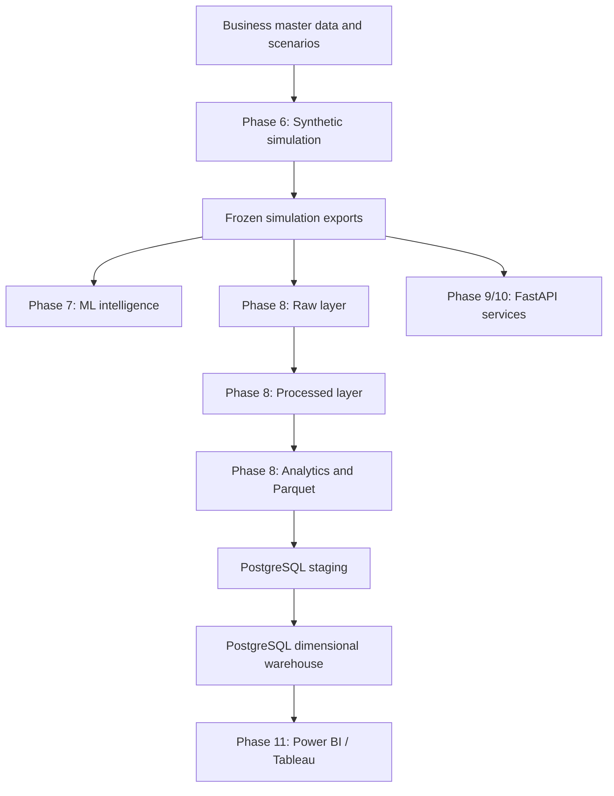

# M14 — Platform Architecture

## End-to-end data flow

The diagram shows logical data dependencies rather than
a single automatically orchestrated execution process.

The API provides services over existing simulation runs;
it should not be assumed to query PostgreSQL for every endpoint.

## Simulation layer

The simulation models customers, shopping events, behavior,
conversion decisions and valid orders.

The frozen production reference uses base seed 42 and a
customer-profile RNG offset of +101, producing profile seed 143.

## Data engineering layers

### Raw

Preserves the source simulation exports.

### Processed

Applies data contracts, product availability rules and
transaction/event cleaning.

### Analytics and Parquet

Produces analytics-ready datasets and partitioned storage.

### Warehouse

PostgreSQL includes:

| Dimensions | Facts |
|---|---|
| dim_customers | fact_orders |
| dim_products | fact_events |
| dim_days | fact_daily_metrics |

Each table includes a run_id to distinguish simulation runs.

Foreign-key relationships use run-scoped keys.

## Business intelligence modeling

For Power BI / Tableau:

- Filter or model one simulation run consistently.
- Use dimension-to-fact relationships at the correct grain.
- Avoid direct many-to-many fact joins that multiply measures.
- Use clean orders and events for standard business KPIs.
- Use raw-versus-clean comparisons for validation dashboards.
- Treat simulation_day as a simulation time index.

## Data-quality reconciliation

Frozen production run:

| Layer | Orders | Events |
|---|---:|---:|
| Raw | 2,915 | 96,632 |
| Processed | 2,913 | 96,508 |
| PostgreSQL staging | 2,913 | 96,508 |
| PostgreSQL warehouse | 2,913 | 96,508 |

Two orders for PRD-MAT-006 on days 2 and 4 preceded
its launch on day 6.

The full event-exclusion breakdown is 66 product views,
28 add-to-cart events, 22 cart abandonments,
6 purchase intents and 2 purchases.

The exact cleaning reason for every individual excluded
event has not been separately established.

## Reproducibility

The data platform preserves seed provenance and output
fingerprints for the frozen reference run.

The verification checks existing outputs. It does not
constitute proof from two independent fresh regenerations.
